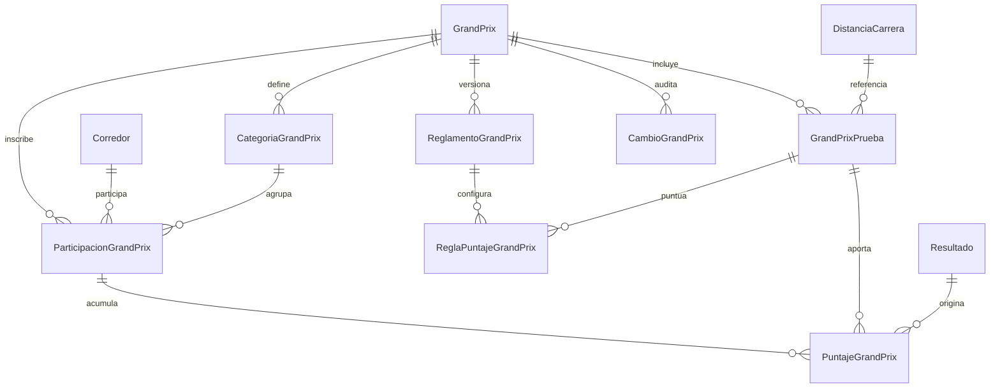

# Grand Prix: módulo de backend

El alcance actual es exclusivamente el backend del Grand Prix. El frontend conserva la versión previa a esta implementación; su integración se realizará en otra etapa.

## Responsabilidad del módulo

El módulo permite crear una edición de un año o período, inscribir corredores, vincular carreras existentes, configurar reglas y acumular puntos según los resultados oficiales. No crea ni administra carreras, distancias, inscripciones a carreras o clasificaciones generales.

Las carreras y sus modalidades son datos aportados por otros módulos del equipo. La vinculación usa `DistanciaCarrera`, porque los resultados e inscripciones actuales ya identifican allí la prueba disputada. Se admiten kilometrajes arbitrarios existentes (5, 10, 21, 30 km u otros), sin límites ni escalas codificadas por kilometraje.



## Persistencia

- `GrandPrix`: edición, fechas, referencia de edad, requisitos y estado.
- `GrandPrixPrueba`: asociación de la edición con una prueba existente.
- `ParticipacionGrandPrix`: inscripción del corredor a una edición específica.
- `CategoriaGrandPrix`: grupos propios del campeonato; independientes de las categorías generales.
- `ReglamentoGrandPrix` y `ReglaPuntajeGrandPrix`: versiones y puntos por puesto/prueba.
- `PuntajeGrandPrix`: aporte de un participante en una prueba, vinculado a su resultado y reglamento.
- `CambioGrandPrix`: historial de las modificaciones y recálculos.

Los modelos existentes solo reciben las relaciones inversas necesarias en `Corredor`, `DistanciaCarrera`, `Resultado` y `Usuario`. Se mantienen intactos los campos de `Carrera`, `Distancia`, `Inscripcion`, `Categoria`, `CriterioCategoria` y `ResultadoCategoria`, así como sus servicios y validaciones generales.

La migración `20261117143000_grand_prix_modular` crea ocho tablas e índices y no altera ni elimina tablas existentes. No requiere un reset. Los acumulados se calculan al consultar a partir de aportes vigentes; no se guarda un total global en `Corredor`.

## Reglas de puntuación

- El puesto se evalúa dentro de la categoría del GP y de la prueba correspondiente. Las escalas son configurables y un puesto sin regla recibe cero puntos.
- `TodosCarrera` considera todos los finalistas oficiales del grupo; `ParticipantesGrandPrix` numera solo a los inscriptos habilitados del campeonato. Solo estos últimos reciben puntos en ambos casos.
- Se consumen resultados oficiales, con clasificación `Finalizo`, inscripción confirmada y kit entregado. El GP no genera esos resultados.
- Cada participación tiene una categoría de puntuación por edición y una fecha fija para calcular la edad. Se rechazan grupos superpuestos y no se modifican condiciones de categorías en uso.
- La afiliación y la admisión de resultados anteriores a la inscripción al GP son configurables.
- Solo se admite un aporte por corredor y evento. Dos modalidades del mismo evento no cuentan como dos carreras a efectos de los mínimos.
- El mínimo de eventos del calendario es independiente del mínimo de carreras completadas por el corredor. Finalizar válidamente con cero puntos cuenta como participación.
- Los empates de puntos comparten posición. En una edición cerrada, los participantes sin requisitos conservan sus puntos y detalle, pero no reciben puesto oficial.

Las categorías de esta versión son excluyentes: campos vacíos de sexo o discapacidad significan condición abierta. Clasificaciones paralelas, descartes de peores resultados, puntos fraccionarios o desempates deportivos adicionales requieren una ampliación posterior.

## Flujo de la API

Base: `/api/grand-prix`. Se exige cookie JWT. Administrador y Clasificador pueden consultar; solo Administrador modifica.

1. Crear la edición con sus fechas y requisitos.
2. Definir las categorías del GP antes de inscribir participantes.
3. Consultar `/catalogo-pruebas` y asociar los identificadores existentes mediante `POST /:id/pruebas` con `{ distanciaCarreraId }`.
4. Inscribir al corredor mediante `POST /:id/participaciones` con `{ corredorId, categoriaId }`. Esto no reemplaza su inscripción a las carreras.
5. Crear y configurar un reglamento con reglas `{ pruebaId, puesto, puntos }`.
6. Previsualizar su impacto sin escribir, o publicarlo y aplicarlo a las pruebas seleccionadas. La API no depende de una pantalla para estas operaciones.
7. Activar la edición, consultar `/:id/tabla` y recalcular cuando corresponda.

Consultar [los endpoints](../api/endpoints.md#grand-prix) para los contratos completos. Se conservan filtros por categoría, sexo, kilometraje y búsqueda para una futura interfaz.

## Versiones, correcciones e integración

Las reglas publicadas son inmutables: se crea otra versión y se eligen las pruebas afectadas. Para pruebas iniciadas o finalizadas se requiere `retroactivo: true`. La versión más nueva no reemplaza automáticamente los puntajes anteriores.

El recálculo sustituye los aportes vigentes en una transacción. La unicidad `(participacionId, pruebaId)` evita duplicarlos. Las pruebas sin reglamento siguen pendientes y no permiten activar una edición incompleta. El historial conserva actor, motivo y valores anteriores/nuevos; el detalle se consulta bajo demanda.

El listener del GP consume `notificarClasificacionActualizada({ carreraId })`. Si otro módulo finaliza una carrera o recibe una corrección por sincronización, debe emitir ese evento o solicitar el recálculo. Una edición cerrada queda advertida y requiere reapertura antes de cambiar sus puntos. Modificar SQL directamente no emite eventos. La sincronización con el sistema web no está implementada en este módulo.

`grandPrix.reglas.ts` contiene cálculo puro. `grandPrix.service.ts` coordina validaciones y persistencia (Fabricación Pura de GRASP). No es necesaria una Factory para nuevas temporadas: son nuevos registros de edición.

Los contratos de salida y sus conversiones se centralizan en `dtos/grandPrix.dto.ts`, siguiendo la decisión arquitectónica de DTO del proyecto. Los servicios declaran sus tipos de retorno y utilizan esos mappers para construir las respuestas, incluidas consultas, historial y acumulados. El controlador recibe parámetros, llama al servicio y responde HTTP; no importa Prisma ni consulta la base directamente. Las fechas siguen representadas como `Date` en los DTO del backend y se serializan como cadenas ISO en JSON, conservando los contratos existentes.

## Verificación y uso del backend

Configurar el `.env` del backend y `DATABASE_URL` según el entorno existente. Ejecutar en `backend`:

```sh
npm run prisma:generate
npm run prisma:migrate-deploy
npm run check
npm test
npm run dev
```

Las pruebas crean sus propias carreras, distancias y resultados en una SQLite temporal para simular lo que proveen los otros módulos. No modifican la base del usuario. Cubren permisos, migración, asociación de ediciones y corredores, kilometrajes 5/10/21/30, puntuación, filtros, cero puntos, mínimos, idempotencia, reglas futuras/retroactivas y correcciones tras el cierre.

No se incluyen pantallas, cambios de navegación, exportaciones visuales ni una carga DEMO que cree carreras en la base del proyecto.
